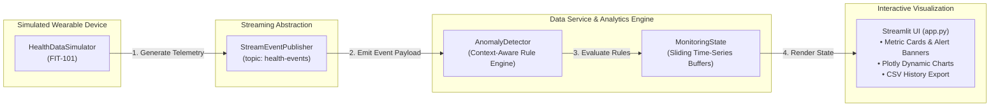
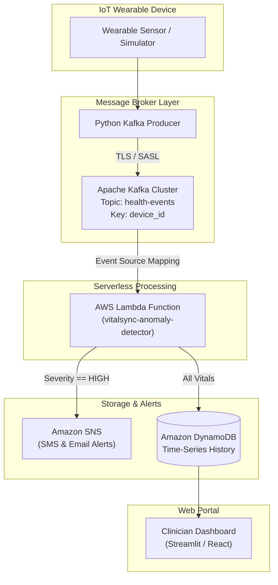

# 🫀 VitalSync: Real-Time Vital Sign Monitoring & Anomaly Detection System


> **B.Tech Computer Science Engineering Capstone / Technical Demonstration Project**  
> *Domain: HealthTech, Internet of Medical Things (IoMT), Real-Time Distributed Streaming, Serverless Cloud Computing*

---

## 1. Project Overview

**VitalSync** is a real-time health telemetry processing prototype designed to continuously ingest streaming physiological vitals from simulated wearable edge sensors, detect anomalous trends via a rule-based detection engine, and provide interactive real-time monitoring and alert triage.

The system monitors multi-parameter physiological vitals:
- **Heart Rate (BPM)** — Resting, exertion, tachycardia, and bradycardia.
- **Blood Pressure (Systolic & Diastolic mmHg)** — Stage 1, Stage 2, and hypertensive crisis thresholds.
- **Oxygen Saturation (SpO₂ %)** — Normal, mild hypoxia, and critical respiratory distress.
- **Body Temperature (°C)** — Normal, febrile, and hypothermic states.
- **Physical Activity Context** — Resting, Walking, and Cardio Exercise.

The project is structured into two phases:
- **Prototype v1 (Current):** A local, modular, reactive web application built using Python, Streamlit, Pandas, and Plotly, with a pluggable streaming event abstraction layer.
- **Phase 2 (Cloud Upgrade):** A distributed cloud deployment leveraging **Apache Kafka**, **AWS Lambda**, **Amazon SNS**, and **Amazon DynamoDB**.

---

## 2. Problem Statement

Conventional hospital telemetry and outpatient remote patient monitoring (RPM) systems face three major technical challenges:
1. **Batch Latency:** Traditional systems transfer vitals at scheduled intervals (e.g., every 30 minutes), delaying intervention during sudden acute decompensations.
2. **False Positives & Alert Fatigue:** Static thresholds that ignore user activity (such as exercising versus sleeping) trigger frequent false alarms, leading to clinician burnout.
3. **Ingestion Bottlenecks:** Centralized relational databases struggle with high-frequency concurrent writes from thousands of streaming wearable devices.

VitalSync demonstrates how an **event-driven, context-aware streaming architecture** solves these limitations through sub-second rule evaluation and activity normalization.

---

## 3. System Objectives

- **Simulate Continuous Vitals:** Generate realistic, physiologically continuous telemetry (Brownian drift + noise) rather than erratic random numbers.
- **Context-Aware Anomaly Detection:** Dynamically adjust thresholds depending on user activity (e.g., 140 BPM is normal during exercise, but alarming while resting).
- **Multi-Parameter & Temporal Detection:** Identify composite health crises (e.g., High HR + Low SpO2) and sudden delta spikes.
- **Alert Triage:** Categorize findings into `NORMAL`, `WARNING`, and `HIGH` severity with transparent, human-readable explanations.
- **Modular Streaming Blueprint:** Decouple the event producer from downstream analytics so Apache Kafka can be plugged in without refactoring core logic.

---

## 4. System Architecture

### 4.1 Prototype v1 Architecture (Current Implementation)



### 4.2 Phase 2 Cloud Architecture (Future Roadmap)



---

## 5. Technology Stack

| Technology | Purpose | Version |
|---|---|---|
| **Python** | Core application logic, simulator, and rule engine | 3.10+ (Tested through 3.14) |
| **Streamlit** | Reactive web dashboard and control panel | >=1.32.0 |
| **Plotly** | Dark-mode interactive time-series charts with threshold bands | >=5.18.0 |
| **Pandas** | Time-series data manipulation and tabular analysis | >=2.1.0 |
| **NumPy** | Numerical operations and statistical calculations | >=1.24.0 |
| **Unittest / Pytest** | Automated unit test suite (14 test cases) | >=7.4.0 |

---

## 6. Anomaly Detection Approach

VitalSync's detection engine (`detection/detection_rules.py`) uses a 6-stage evaluation pipeline:

1. **Sensor Integrity Check:** Catches missing values, `None` fields, and physically impossible inputs (e.g. HR $\le 0$ or $> 260$ BPM, SpO2 $> 100\%$, Systolic $\le$ Diastolic).
2. **Activity Context Normalization:** Distinguishes between `Resting`, `Walking`, and `Exercise`. High HR and elevated systolic pressure are tolerated during exercise.
3. **Single-Parameter Thresholds:** Evaluates vital readings against configurable demonstration limits for resting tachycardia, bradycardia, hypoxia, and hypertension.
4. **Temporal Delta Detection:** Flags sudden rate-of-change spikes (e.g., HR jumping $> 25$ BPM or SpO2 dropping $\ge 4\%$ in a single interval without activity change).
5. **Multi-Parameter Correlation:** Flags composite crises, such as Cardiorespiratory Distress ($\text{HR} > 115 \text{ BPM} + \text{SpO2} < 93\%$) and Febrile Hypertension ($\text{Systolic} \ge 150 \text{ mmHg} + \text{Temp} \ge 38.2^\circ\text{C}$).
6. **Persistence Escalation:** If abnormal readings persist for 3 or more consecutive intervals, warning alerts are escalated to `HIGH`.

---

## 7. Sample Data Schema (Topic: `health-events`)

The standardized JSON payload generated for each event:

```json
{
  "topic": "health-events",
  "key": "FIT-101",
  "timestamp": "2026-11-26 12:45:00",
  "data": {
    "device_id": "FIT-101",
    "sequence_number": 105,
    "timestamp": "2026-11-26 12:45:00",
    "heart_rate": 165.2,
    "systolic_bp": 142.0,
    "diastolic_bp": 90.0,
    "spo2": 88.5,
    "temperature": 37.1,
    "activity": "Resting",
    "scenario": "Multiple Unusual Readings (Critical Distress)",
    "is_simulated": true
  },
  "cloud_metadata": {
    "schema_version": "1.0",
    "producer": "VitalSync-LocalSimulator",
    "target_lambda_arn": "arn:aws:lambda:us-east-1:123456789012:function:vitalsync-anomaly-detector"
  }
}
```

---

## 8. Project Folder Structure

```
VitalSync/
├── app.py                         # Main Streamlit dashboard application
├── requirements.txt               # Python package dependencies
├── .gitignore                     # Git ignore specifications
├── .streamlit/
│   └── config.toml                # Dark navy & teal theme configuration
├── simulator/
│   ├── __init__.py
│   └── health_generator.py        # Physiological drift simulator & scenarios
├── detection/
│   ├── __init__.py
│   └── detection_rules.py         # Modular rule engine & activity evaluator
├── services/
│   ├── __init__.py
│   └── data_service.py            # Sliding window buffer & Kafka abstraction
├── components/
│   ├── __init__.py
│   └── dashboard_components.py    # Metric cards, alert banners & Plotly charts
├── tests/
│   ├── __init__.py
│   ├── test_detection.py          # 11 Unit tests for detection rules
│   └── test_services.py           # 3 Integration tests for simulator & buffers
└── docs/
    ├── architecture.md            # Technical architecture specification
    └── project_overview.md        # Academic defense guide for faculty review
```

---

## 9. Installation & Setup Instructions (macOS & Windows)

### 9.1 Prerequisites
- **Python 3.10 or higher** installed. Check via:
  ```bash
  python3 --version
  ```
- **Terminal (macOS)** or **PowerShell (Windows)**.

### 9.2 Setup on macOS (MacBook Air M2 / Intel)

1. **Open Terminal** and navigate into the `VitalSync` directory:
   ```bash
   cd VitalSync
   ```

2. **Create a virtual environment:**
   ```bash
   python3 -m venv venv
   ```

3. **Activate the virtual environment:**
   ```bash
   source venv/bin/activate
   ```
   *(Your terminal prompt should now show `(venv)`)*

4. **Upgrade pip and install dependencies:**
   ```bash
   pip install --upgrade pip
   pip install -r requirements.txt
   ```

5. **Run the automated test suite:**
   ```bash
   python -m unittest discover tests -v
   ```
   *Expected output: `Ran 14 tests ... OK`*

6. **Launch the VitalSync Dashboard:**
   ```bash
   streamlit run app.py
   ```
   *The application will open automatically in your browser at `http://localhost:8501`.*

---

## 10. How to Demonstrate the Project to Faculty

Follow this step-by-step walkthrough during your viva or project presentation:

### Step 1: Baseline Normal Operation
1. Launch the app (`streamlit run app.py`).
2. Point out the top header: Device ID (`FIT-101`), Status (`NORMAL`), and Scenario (`Normal Resting`).
3. Click **"▶ Start Live"** or click **"⏩ Step (+1)"** several times.
4. Show how the vital KPI cards update and how Plotly charts show realistic physiological drift within normal boundaries.

### Step 2: Triggering Context-Aware Exercise
1. In the sidebar dropdown, select **"🏃 Exercise (Cardio Workout)"**.
2. Click **"⏩ Step (+1)"** 3–4 times.
3. **Key Explanation to Faculty:** *“Notice that the Heart Rate rises above 135 BPM and systolic pressure rises to 140 mmHg, but the status remains **NORMAL**! Our detection engine uses activity context normalization, understanding that high heart rate during cardio exercise is expected and not an anomaly.”*

### Step 3: Triggering a Simulated Anomaly (Tachycardia at Rest)
1. In the sidebar, select **"⚠️ Unusual Heart Rate (Tachycardia)"**.
2. Click **"⏩ Step (+1)"**.
3. **Demonstration Point:** The Heart Rate jumps to ~165 BPM while activity is **Resting**. The dashboard immediately turns **RED** with a **CRITICAL ALERT** banner explaining:
   *`Severe tachycardia (165.0 BPM) while Resting. Well above resting critical ceiling (130 BPM).`*
4. Switch to the **"🚨 Anomaly & Alert Center"** tab to show the alert log entry with rule ID `RULE_RESTING_CRITICAL_TACHYCARDIA`.

### Step 4: Demonstrating Hypoxia & Multi-Parameter Correlation
1. Select **"🚨 Multiple Anomalies (Critical Crisis)"**.
2. Click **"⏩ Step (+1)"**.
3. Point out that the system detected multiple simultaneous violations: Severe Hypertension + Critical Hypoxia (< 90%) + High Fever, triggering the composite clinical distress rule `RULE_MULTI_CARDIORESPIRATORY_DISTRESS`.

### Step 5: Live Threshold Tuning
1. Expand the **"⚙️ Configurable Detection Thresholds"** panel in the sidebar.
2. Adjust the **SpO2 Warning Threshold** slider from 94% to 96%.
3. Explain to faculty: *“All thresholds are dynamically configurable at runtime without changing the underlying detection engine.”*

### Step 6: Explaining the Cloud & Kafka Roadmap
1. Click the **"☁️ Kafka & Cloud Architecture"** tab.
2. Show the serialized JSON payload: *“Here is the exact message structure formatted for the Kafka topic `health-events`. In Phase 2, this is sent over SSL to an AWS MSK Kafka cluster, where AWS Lambda processes batches serverlessly.”*

---

## 11. Implemented Features vs. Planned Roadmap

| Component | Status in Prototype v1 | Planned for Phase 2 |
|---|---|---|
| **Synthetic Sensor** | ✅ Implemented (Brownian drift & 8 scenarios) | ESP32 / Wearable Bluetooth sensor |
| **Anomaly Detection** | ✅ Implemented (Multi-stage rule engine) | AWS Lambda microservice |
| **Temporal Deltas** | ✅ Implemented (Rate of change checks) | Time-series sliding window in ElastiCache |
| **Activity Awareness** | ✅ Implemented (Resting vs Walking vs Exercise) | Accelerometer ML classifier |
| **Alert Presentation** | ✅ Implemented (Color-coded badges & banners) | Amazon SNS (SMS & Email alerts) |
| **Kafka Integration** | ⚠️ Abstraction Prepared (`StreamEventPublisher`) | Managed Kafka (AWS MSK / Confluent) |
| **Persistent Storage** | ⚠️ Sliding window buffer (in-memory) | Amazon DynamoDB NoSQL table |

---

## 12. Limitations

- **Simulated Hardware:** Prototype v1 uses synthetic generation rather than real physical Bluetooth sensors.
- **Local Runtime:** In v1, events flow through Python memory structures rather than external network sockets.
- **Demonstration Rules:** Thresholds are based on clinical reference ranges for educational purposes and do not substitute certified medical algorithms.

---

## 13. Safety & Educational Disclaimer

> [!IMPORTANT]
> **Academic & Technical Demonstration Notice:**  
> VitalSync is developed exclusively for academic, engineering, and educational purposes to demonstrate stream processing and serverless event-driven architectures. It is **not** a certified medical diagnostic device and must not be used for medical decision-making or diagnosis.
