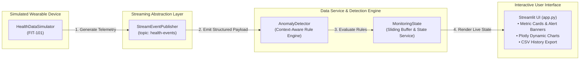
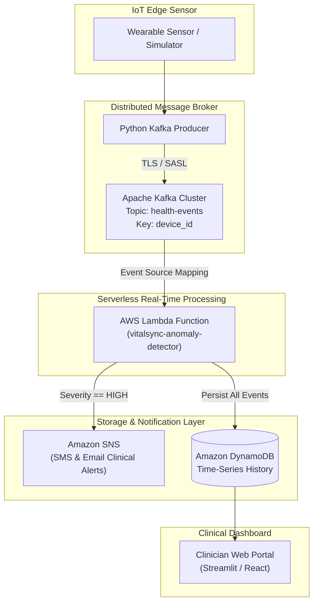

# 🫀 VitalSync: Real-Time Vital Sign Monitoring & Anomaly Detection System


> **B.Tech Computer Science & Engineering Capstone Project**  
> *Domain: HealthTech, Internet of Medical Things (IoMT), Real-Time Distributed Streaming, Cloud Computing*

---

## 1. Project Overview

**VitalSync** is a real-time health telemetry monitoring and anomaly detection prototype designed to continuously ingest physiological vitals, evaluate them against a context-aware rule engine, and present real-time alerts and interactive visualizations.

The system tracks key physiological parameters:
- **Heart Rate (BPM)** — Resting, exertion, tachycardia, and bradycardia.
- **Blood Pressure (Systolic & Diastolic mmHg)** — Normal, Stage 1 Hypertension, and Stage 2 Hypertensive Crisis.
- **Oxygen Saturation (SpO₂ %)** — Normal, mild hypoxia, and critical respiratory distress.
- **Body Temperature (°C)** — Normal, febrile state, and hypothermia.
- **Physical Activity Context** — Resting, Walking, and Cardio Exercise.

The project is structured in two stages:
- **Prototype v1 (Current):** A fully functional local and cloud-deployable web application built with Python, Streamlit, Pandas, and Plotly, featuring a modular streaming event abstraction layer.
- **Phase 2 (Cloud Upgrade Roadmap):** A distributed cloud architecture integrating **Apache Kafka**, **AWS Lambda**, **Amazon SNS**, and **Amazon DynamoDB**.

---

## 2. Problem Statement

Traditional hospital telemetry and remote patient monitoring (RPM) systems face three fundamental limitations:
1. **Batch Transfer Latency:** Vitals are often transferred in scheduled batches (e.g., every 15–30 minutes), which can delay intervention during acute clinical crises.
2. **False Positives & Alert Fatigue:** Static thresholds that fail to account for patient activity (e.g., elevated heart rate during exercise vs. rest) generate frequent false alarms.
3. **Ingestion Bottlenecks:** Centralized relational databases struggle to handle high-frequency writes from thousands of concurrent wearable sensor streams.

VitalSync demonstrates how an **event-driven, activity-aware streaming architecture** addresses these bottlenecks through real-time telemetry processing and contextual normalization.

---

## 3. System Objectives

- **Physiologically Realistic Simulation:** Generate time-series data using Brownian drift and physiological inertia rather than erratic white noise.
- **Context-Aware Anomaly Detection:** Dynamically adjust thresholds based on patient activity (e.g., 140 BPM is normal during cardio exercise, but flagged during rest).
- **Multi-Parameter & Temporal Detection:** Detect composite health crises (e.g., high HR combined with low SpO₂) and sudden rate-of-change spikes.
- **Transparent Alert Triage:** Categorize events into `NORMAL`, `WARNING`, and `HIGH` severity with human-readable clinical rationale.
- **Cloud-Ready Streaming Contract:** Decouple data generation from analytics using a standardized Kafka event envelope (`health-events`).

---

## 4. System Architecture

### 4.1 Prototype v1 Architecture (Current Implementation)



### 4.2 Phase 2 Cloud Architecture (Future Roadmap)



---

## 5. Technology Stack

| Technology | Purpose | Version |
|---|---|---|
| **Python** | Application core, simulator, and rule engine | 3.10+ (Tested through 3.14) |
| **Streamlit** | Reactive web dashboard and control panel | >=1.32.0 |
| **Plotly** | Dark-mode interactive time-series graphs with threshold lines | >=5.18.0 |
| **Pandas** | Time-series data manipulation and tabular analysis | >=2.1.0 |
| **NumPy** | Numerical calculations and baseline array operations | >=1.24.0 |
| **Unittest / Pytest** | Automated test suite (14 test cases) | Built-in / >=7.4.0 |

---

## 6. Anomaly Detection Engine

The detection engine (`detection/detection_rules.py`) evaluates incoming readings through a 6-stage pipeline:

1. **Payload Integrity Check:** Validates missing fields, `None` values, and physically impossible entries ($\text{HR} \le 0$ or $> 260$ BPM, $\text{SpO}_2 > 100\%$, $\text{Systolic} \le \text{Diastolic}$).
2. **Activity Context Normalization:** Distinguishes between `Resting`, `Walking`, and `Exercise`. Exertional cardiovascular response is normalized during workouts.
3. **Single-Parameter Thresholds:** Evaluates vitals against configurable demonstration limits:
   - **Heart Rate:** Resting normal 60–100 BPM; Warning 101–130 BPM; Critical > 130 BPM or < 50 BPM (bradycardia).
   - **Blood Pressure:** Normal < 130/85 mmHg; Stage 1 Warning ≥ 130/85 mmHg; Stage 2 Crisis ≥ 145/95 mmHg.
   - **Oxygen Saturation (SpO₂):** Normal ≥ 95%; Mild Hypoxia 90–94%; Critical Hypoxia < 90%.
   - **Temperature:** Normal 36.1–37.5°C; Fever Warning ≥ 37.6°C; High Fever ≥ 38.5°C; Hypothermia < 35.0°C.
4. **Temporal Delta Detection:** Identifies sudden single-step spikes ($\Delta\text{HR} \ge 25$ BPM or $\Delta\text{SpO}_2 \ge 4\%$ drop without activity change).
5. **Multi-Parameter Correlation:** Flags composite crises such as Cardiorespiratory Distress ($\text{HR} > 115 \text{ BPM} + \text{SpO}_2 < 93\%$) and Febrile Hypertension ($\text{Systolic} \ge 150 \text{ mmHg} + \text{Temp} \ge 38.2^\circ\text{C}$).
6. **Persistence Escalation:** If abnormal readings persist for 3 or more consecutive intervals, warning alerts are escalated to `HIGH`.

---

## 7. Simulation Scenarios

The simulator includes preset scenarios selectable from the sidebar:

| # | Scenario Name | Target Physiological State | Primary Alert Triggered |
|---|---|---|---|
| 1 | **Normal Resting** | HR 72 BPM, BP 118/78 mmHg, SpO₂ 98.5% | `NORMAL` |
| 2 | **Walking Activity** | HR 95 BPM, BP 125/81 mmHg, SpO₂ 98.0% | `NORMAL` |
| 3 | **Exercise (Cardio Workout)** | HR 140 BPM, BP 142/84 mmHg, SpO₂ 96.5% | `NORMAL` (Context-normalized) |
| 4 | **Low Heart Rate (Bradycardia Warning)** | **HR 44 BPM**, BP 115/75 mmHg, SpO₂ 98.5% | `WARNING` (`RULE_BRADYCARDIA_LOW_HEART_RATE`) |
| 5 | **Elevated Heart Rate (Tachycardia Warning)** | **HR 108 BPM**, BP 124/82 mmHg, SpO₂ 98.0% | `WARNING` (`RULE_RESTING_ELEVATED_TACHYCARDIA`) |
| 6 | **Extreme Heart Rate (Severe Tachycardia)** | **HR 168 BPM**, BP 138/88 mmHg, SpO₂ 97.0% | `HIGH` (`RULE_RESTING_CRITICAL_TACHYCARDIA`) |
| 7 | **High BP (Stage 1 Warning)** | HR 74 BPM, **BP 136/88 mmHg**, SpO₂ 98.5% | `WARNING` (`RULE_STAGE_1_HYPERTENSION`) |
| 8 | **Severe BP (Stage 2 Crisis)** | HR 78 BPM, **BP 168/104 mmHg**, SpO₂ 98.0% | `HIGH` (`RULE_CRITICAL_HYPERTENSION`) |
| 9 | **Unusual SpO₂ (Hypoxia Event)** | HR 112 BPM, BP 128/82 mmHg, **SpO₂ 87.5%** | `HIGH` (`RULE_CRITICAL_HYPOXIA`) |
| 10 | **Multiple Anomalies (Critical Crisis)** | **HR 172 BPM**, **BP 175/108**, **SpO₂ 86%**, **Temp 39.1°C** | `HIGH` (`RULE_MULTI_CARDIORESPIRATORY_DISTRESS`) |
| 11 | **Sudden Delta Spike** | Instantaneous jump of +40 BPM at rest | `WARNING` (`RULE_SUDDEN_HR_SPIKE`) |
| 12 | **Sensor Glitch / Invalid Data** | Negative values, SpO₂ > 100%, or missing fields | `HIGH` (`RULE_DATA_VALIDATION_ERROR`) |

---

## 8. Sample Kafka Payload (Topic: `health-events`)

Every generated event conforms to this standard JSON envelope:

```json
{
  "topic": "health-events",
  "key": "FIT-101",
  "timestamp": "2026-11-26 12:45:00",
  "data": {
    "device_id": "FIT-101",
    "sequence_number": 42,
    "timestamp": "2026-11-26 12:45:00",
    "heart_rate": 168.2,
    "systolic_bp": 138.0,
    "diastolic_bp": 88.0,
    "spo2": 97.2,
    "temperature": 37.1,
    "activity": "Resting",
    "scenario": "Unusual Heart Rate (Tachycardia)",
    "is_simulated": true
  },
  "cloud_metadata": {
    "schema_version": "1.0",
    "producer": "VitalSync-LocalSimulator",
    "target_lambda_arn": "arn:aws:lambda:us-east-1:123456789012:function:vitalsync-anomaly-detector"
  }
}
```

---

## 9. Project Directory Structure

```
VitalSync/
├── app.py                         # Main Streamlit dashboard application
├── requirements.txt               # Project dependencies
├── .gitignore                     # Git ignore rules
├── .streamlit/
│   └── config.toml                # Dark navy (#0A1128) and teal theme configuration
├── simulator/
│   ├── __init__.py
│   └── health_generator.py        # Physiological drift generator & 10 scenarios
├── detection/
│   ├── __init__.py
│   └── detection_rules.py         # 6-stage rule engine & activity normalization
├── services/
│   ├── __init__.py
│   └── data_service.py            # Sliding time-series buffer & Kafka abstraction
├── components/
│   ├── __init__.py
│   └── dashboard_components.py    # Metric cards, alert banners & Plotly charts
├── tests/
│   ├── __init__.py
│   ├── test_detection.py          # 11 Unit tests for detection rules
│   ├── test_services.py           # 3 Integration tests for simulator & buffers
│   └── test_cloud.py              # 4 Phase 2 tests for Kafka & AWS Lambda
├── cloud/
│   ├── __init__.py
│   ├── docker-compose.yml         # Apache Kafka (KRaft) + Kafka Web UI
│   ├── kafka_producer.py          # Standalone Kafka producer script
│   ├── kafka_consumer.py          # Standalone Kafka consumer runner
│   ├── lambda_function.py         # AWS Lambda handler (ESM + SNS + DynamoDB)
│   └── deploy_cloud.md            # Step-by-step AWS deployment guide
└── docs/
    ├── architecture.md            # Technical architecture specification
    └── project_overview.md        # Academic defense guide for faculty review
```

---

## 10. Installation & Running Instructions

### Prerequisites
- Python 3.10 or higher installed (`python --version` or `python3 --version`).
- Git installed.

---

### Running on macOS (MacBook Air M2 / Intel)

1. **Clone the repository and enter the directory:**
   ```bash
   git clone https://github.com/komal-004/VitalSync.git
   cd VitalSync
   ```

2. **Create and activate a virtual environment:**
   ```bash
   python3 -m venv venv
   source venv/bin/activate
   ```

3. **Install dependencies:**
   ```bash
   pip install --upgrade pip
   pip install -r requirements.txt
   ```

4. **Run the automated test suite:**
   ```bash
   python -m unittest discover tests -v
   ```

5. **Launch the dashboard:**
   ```bash
   python3 -m streamlit run app.py
   ```
   *The application opens automatically at `http://localhost:8501`.*

---

### Running on Windows

1. **Open PowerShell and navigate to the project directory:**
   ```powershell
   cd "VitalSync"
   ```

2. **Install dependencies:**
   ```powershell
   pip install -r requirements.txt
   ```

3. **Run the automated test suite:**
   ```powershell
   python -m unittest discover tests -v
   ```

4. **Launch the dashboard:**
   ```powershell
   python -m streamlit run app.py
   ```

---

### Running Live on the Web (Streamlit Cloud - 100% Free)

1. Visit **[share.streamlit.io](https://share.streamlit.io)** and sign in with GitHub.
2. Click **Create app**.
3. Select your repository: `komal-004/VitalSync`, branch: `main`, main file: `app.py`.
4. Click **Deploy**. The app will be live on a public URL in 1–2 minutes.

---

## 11. Faculty Demonstration Walkthrough

1. **Baseline Normal Operation:**
   - Launch the dashboard (`python -m streamlit run app.py`).
   - Notice the header: Device `FIT-101`, Status `NORMAL`.
   - Click **"▶ Start Live"** or **"⏩ Step (+1)"**.
   - Observe realistic physiological variation within normal bands on all 4 Plotly charts.

2. **Activity Context Normalization (Exercise Test):**
   - In the sidebar dropdown, select **"🏃 Exercise (Cardio Workout)"**.
   - Notice Heart Rate reaches ~140 BPM and Systolic BP reaches ~142 mmHg, yet status remains **NORMAL**.
   - *Key takeaway for faculty:* The engine uses activity context normalization to prevent false alarms during physical exertion.

3. **Stage 1 Blood Pressure Warning:**
   - Select **"⚠️ Unusual Blood Pressure (Stage 1 Warning: 136/88)"**.
   - The Blood Pressure card immediately highlights in **Amber**.
   - The alert banner displays: `WARNING FLAGGED: Stage 1 Hypertension (136.0/88.0 mmHg) exceeds threshold (130/85 mmHg)`.

4. **Stage 2 Blood Pressure Crisis:**
   - Select **"🚨 Unusual Blood Pressure (Stage 2 Crisis: 168/104)"**.
   - The Blood Pressure card immediately turns **Red**.
   - The alert banner displays: `CRITICAL ALERT: Hypertensive crisis (168.0/104.0 mmHg) exceeds critical threshold (145/95 mmHg)`.

5. **Multi-Parameter Cardiorespiratory Distress:**
   - Select **"🚨 Multiple Anomalies (Critical Crisis)"**.
   - The engine flags composite distress: Tachycardia + Acute Hypoxia (< 90%) + High Fever (`RULE_MULTI_CARDIORESPIRATORY_DISTRESS`).

6. **Runtime Threshold Tuning:**
   - Expand **"⚙️ Configurable Detection Thresholds"** in the sidebar.
   - Adjust the **Systolic BP Warning** slider; the current reading re-evaluates immediately on screen.

7. **Kafka & Cloud Readiness:**
   - Open the **"☁️ Kafka & Cloud Architecture"** tab.
   - Inspect the standardized JSON message ready for Apache Kafka topic `health-events`.

---

## 12. Implemented Features vs. Planned Roadmap

| Component | Status in Prototype v1 | Planned for Phase 2 |
|---|---|---|
| **Data Simulator** | ✅ Implemented (Brownian drift & 10 scenarios) | ESP32 / Physical BLE wearable sensor |
| **Detection Engine** | ✅ Implemented (6-stage context-aware engine) | AWS Lambda serverless microservice |
| **Alert Presentation** | ✅ Implemented (Color-coded KPI cards & banners) | Amazon SNS (SMS & Email notifications) |
| **Time-Series Charts** | ✅ Implemented (4 dynamic Plotly charts) | Amazon CloudWatch / Grafana dashboard |
| **Data Persistence** | ✅ Implemented (Sliding window buffer & CSV export) | Amazon DynamoDB NoSQL database |
| **Message Broker** | ⚠️ Abstraction Prepared (`StreamEventPublisher`) | Apache Kafka cluster (AWS MSK / Confluent) |

---

## 13. Limitations

- **Simulated Telemetry:** Prototype v1 uses deterministic synthetic generation rather than physical medical hardware.
- **In-Memory Streaming:** Events in v1 pass through internal Python queues rather than network socket brokers.
- **Demonstration Criteria:** Thresholds follow clinical reference ranges for technical demonstration and do not constitute certified diagnostic algorithms.

---

## 14. Safety & Medical Disclaimer

> [!IMPORTANT]
> **Academic Demonstration Notice:**  
> VitalSync is developed exclusively for educational and technical demonstration purposes to illustrate stream processing and event-driven architectures. It is **not** a certified medical diagnostic device and must never be used for clinical decision-making.

---

## 15. License

This project is licensed under the MIT License — see the repository for details.
