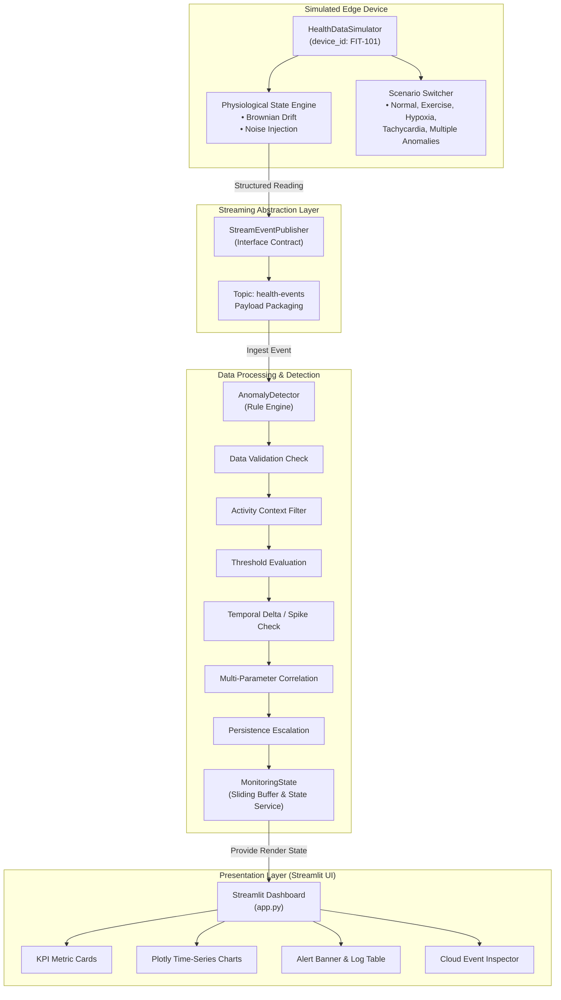
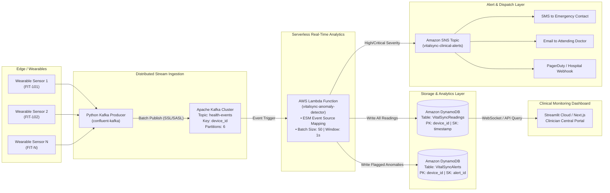

# VitalSync Architecture Specification

## 1. System Overview

**VitalSync** is a real-time vital sign monitoring and anomaly detection platform designed to continuously ingest physiological telemetric data, identify abnormal health indicators, and trigger priority alerts.

This document details both:
1. **Prototype v1 Architecture** — Fully functional local system.
2. **Phase 2 Cloud Architecture** — Scalable distributed streaming system using Apache Kafka and AWS Serverless services.

---

## 2. Prototype v1 Architecture (Current Implementation)

Prototype v1 is built with a strictly decoupled modular design to ensure zero-friction migration to Apache Kafka and AWS Lambda in Phase 2.



### Component Details

| Module | Location | Responsibility |
|---|---|---|
| **Health Simulator** | `simulator/health_generator.py` | Generates realistic, continuous physiological readings with Brownian variation and scenario triggers. |
| **Detection Engine** | `detection/detection_rules.py` | Standalone rule engine evaluating single, delta, composite, and sustained physiological conditions. |
| **Data Service** | `services/data_service.py` | Maintains a bounded sliding window of readings (`deque(maxlen=60)`), alert history, and statistics. |
| **Streaming Abstraction** | `services/data_service.py` | Stages serialized payloads using the standardized Kafka schema without needing external brokers in v1. |
| **User Interface** | `app.py` & `components/` | Streamlit web application with custom CSS styling, Plotly charts, and live interactive controls. |

---

## 3. Phase 2 Cloud Architecture (Distributed Roadmap)

In Phase 2, the local in-memory event bus is replaced by an enterprise cloud streaming pipeline.



---

## 4. Standard Event Schema (Kafka Topic: `health-events`)

Every event sent to the broker adheres to the following JSON specification:

```json
{
  "topic": "health-events",
  "key": "FIT-101",
  "timestamp": "2026-11-26 12:30:15",
  "data": {
    "device_id": "FIT-101",
    "sequence_number": 42,
    "timestamp": "2026-11-26 12:30:15",
    "heart_rate": 142.5,
    "systolic_bp": 138.0,
    "diastolic_bp": 88.0,
    "spo2": 97.2,
    "temperature": 37.1,
    "activity": "Resting",
    "scenario": "Unusual Heart Rate (Tachycardia)",
    "is_simulated": true
  },
  "cloud_metadata": {
    "schema_version": "1.0",
    "producer": "VitalSync-LocalSimulator",
    "target_lambda_arn": "arn:aws:lambda:us-east-1:123456789012:function:vitalsync-anomaly-detector"
  }
}
```

---

## 5. Architectural Design Principles

1. **Separation of Concerns:**
   The detection rules have zero dependencies on the presentation framework (Streamlit) or data storage layer.
2. **Context-Aware Processing:**
   Rules take into account physiological state (e.g. "Exercise" vs "Resting"), preventing false positives.
3. **Pluggable Event Emitter:**
   The `StreamEventPublisher` class mirrors the API of `kafka-python` / `confluent-kafka`, making the future transition purely a matter of dependency configuration.
4. **Idempotence & Statelessness:**
   The Lambda function in Phase 2 executes as a stateless function, fetching recent time-series state from DynamoDB or ElastiCache Redis for temporal window queries.
